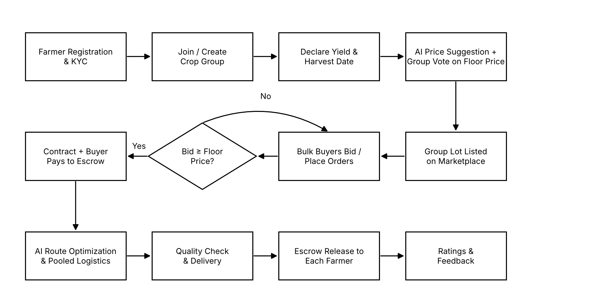

# Smart India Hackathon Workshop
# Date: 24.11.2026
## Reference Number: 26018672
## Name: KASTHURIRAM ROSHAN G B

## Problem Title
SIH 26033: Multiple intermediaries reduce farmers earnings and increase consumer prices.

## Problem Creater's Organization
Ministry of Consumer Affairs, Food & Public Distribution

## Theme
Agriculture, FoodTech & Rural Development

## Problem Description
Expected Solution: Create a digital marketplace that:

• Connects farmers/FPOs directly with consumers and bulk buyers.
• Provides logistics support.
• Uses AI for demand forecasting and route optimization.

Benefits:

• Better prices for farmers.
• Lower prices for consumers.
• Reduced supply chain inefficiencies.

## Proposed Solution
Detailed explanation of the proposed solution

<b>AgriShare</b> is a collaborative agriculture trading platform where individual small and marginal farmers form digital groups (virtual FPO-style clusters) by crop, region or season. Instead of selling alone to local middlemen, the group negotiates as one unit with bulk buyers (retailers, restaurants, food processors, institutions, exporters).

How it addresses the problem

1. Many middlemen take large margins: Direct farmer-group to buyer deals remove commission agents 
2. Individual farmers have weak bargaining power: Collective volume and a group floor price give negotiating strength 
3. Farmers lack price information: Live price discovery and AI price suggestions 
4. High logistics cost, wastage: Pooled transport, route optimization, storage tie-ups 
5. Delayed or uncertain payments: Escrow-based direct bank transfer 
6. Consumers pay inflated prices: Shorter supply chain lowers the final price 

Innovation and uniqueness of the solution

AgriShare is built around group selling, which is its main difference from ordinary agri marketplaces. Farmers form crop-based groups and vote on a floor price, supported by AI price suggestions based on mandi trends and input costs. Bulk buyers can book produce before harvest, which reduces unsold stock and wastage. Payments are held in escrow and released directly to each farmer's bank account in proportion to the quantity they supplied. Pooled transport with AI route optimization lowers logistics costs, and voice support, regional languages and an SMS/WhatsApp fallback make the platform easy for farmers with low digital literacy. KYC, quality grading and ratings for both farmers and buyers build trust across the whole chain.

## Technical Approach
Technologies to be used 

1. Mobile app (farmers): Flutter or React Native, voice input, offline-first
2. Web portal (buyers/admin): React.js, Tailwind CSS
3. Backend: Node.js (Express) or Django REST
4. Database: PostgreSQL (+ PostGIS for location), Redis (cache)
5. AI/ML: Python with Prophet, LSTM and XGBoost for demand and price forecasting
6. Route optimization: Google OR-Tools (vehicle routing), OpenStreetMap / Google Maps API
7. Payments: UPI / Razorpay with escrow flow
8. Notifications: Firebase, SMS, WhatsApp Business API
9. Language: Bhashini / Google Translate API for regional languages
10. Data sources: Agmarknet, eNAM, IMD weather data
11. Security: JWT auth, OTP login, KYC verification, HTTPS
12. Hosting: AWS / Azure / GCP

Methodology and process for implementation 

## Feasibility and Viability
Analysis of the feasibility of the idea

1. Uses mature, proven technologies (mobile apps, UPI, maps, ML forecasting).
2. India has a large FPO ecosystem, eNAM and government schemes that AgriShare can plug into.
3. Revenue from a small transaction fee (1–2%) charged to buyers, logistics margin, and premium analytics. Farmers use it free.
4. Smartphone and UPI penetration in rural India is growing, and group selling matches how farmers already cooperate.

Potential challenges and risks

1. Low digital literacy among farmers
2. Poor internet connectivity in rural areas
3. Trust issues between farmers, groups and buyers
4. Quality inconsistency across a group's produce
5. Disputes over pricing or payment shares
6. Perishability and logistics delays
7. Resistance from existing middlemen and traders

Strategies for overcoming these challenges

1. Voice-based, regional-language, icon-driven UI, and training through FPOs, Krishi Vigyan Kendras and local agents ("Agri-mitras")
2. Offline-first app with SMS/WhatsApp fallback
3. Escrow payments, KYC verification and a rating system to build trust
4. Standard quality grading with photo evidence and collection-point checks
5. Transparent contribution records and an in-app dispute-resolution process
6. Cold storage tie-ups and demand matching before harvest to cut spoilage
7. Pilot with cooperative groups first, then scale, and onboard local traders as logistics partners rather than competitors

## Impact and Benefits
Potential impact on the target audience:

1. Higher realized prices, assured floor price, faster and transparent payments, better bargaining power.
2. Reliable supply, quality assurance, lower procurement cost, traceability.
3. Lower prices and fresher produce through a shorter supply chain.
4. Better data for planning, price monitoring and policy.

Benefits of the solution:

1. Farmers earn more, consumers pay less, and middleman margins shrink.
2. Strengthens farmer collectives, financial inclusion through direct bank payments, and rural empowerment.
3. Less food wastage and optimized routes mean lower fuel use and emissions. Demand forecasting reduces overproduction.
4. Greater transparency and efficiency across the agriculture supply chain.

## Research and References
1. eNAM – National Agriculture Market: https://enam.gov.in
2. Agmarknet (mandi price data): https://agmarknet.gov.in
3. Government scheme for formation and promotion of 10,000 FPOs (Ministry of Agriculture & Farmers Welfare): https://agriculture.gov.in
4. ONDC (Open Network for Digital Commerce): https://ondc.org
5. Bhashini (Indian language AI platform): https://bhashini.gov.in
6. Google OR-Tools (vehicle routing): https://developers.google.com/optimization/routing